## Hey it's cw!

I build internal enterprise apps: the everyday tools teams rely on to plan, track and get work done. I like making them a bit more fun along the way.

I'm also really into AI: coding with AI tools, agents that take on real multi-step work, and bringing practical AI into business apps.

```console
$ whoami
cw239, builds internal enterprise apps

$ cat interests.txt
ai · ai coding tools · agents & automation · ai in business apps

$ ls ~/toolbox
typescript  react  node  postgres  azure  claude-code
```

## 🧰 Toolbox


